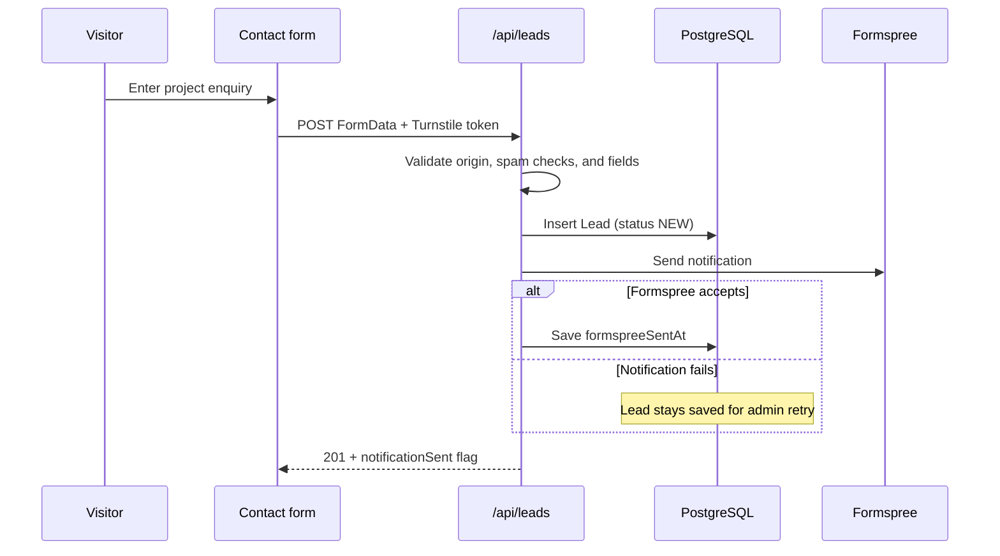
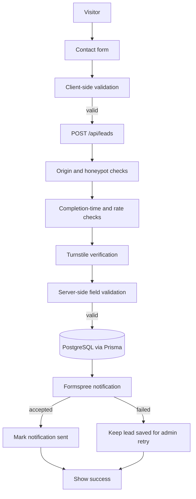
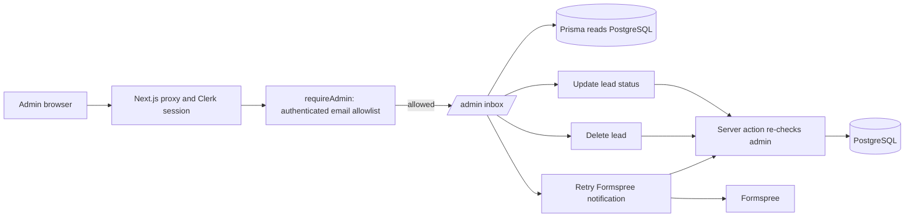
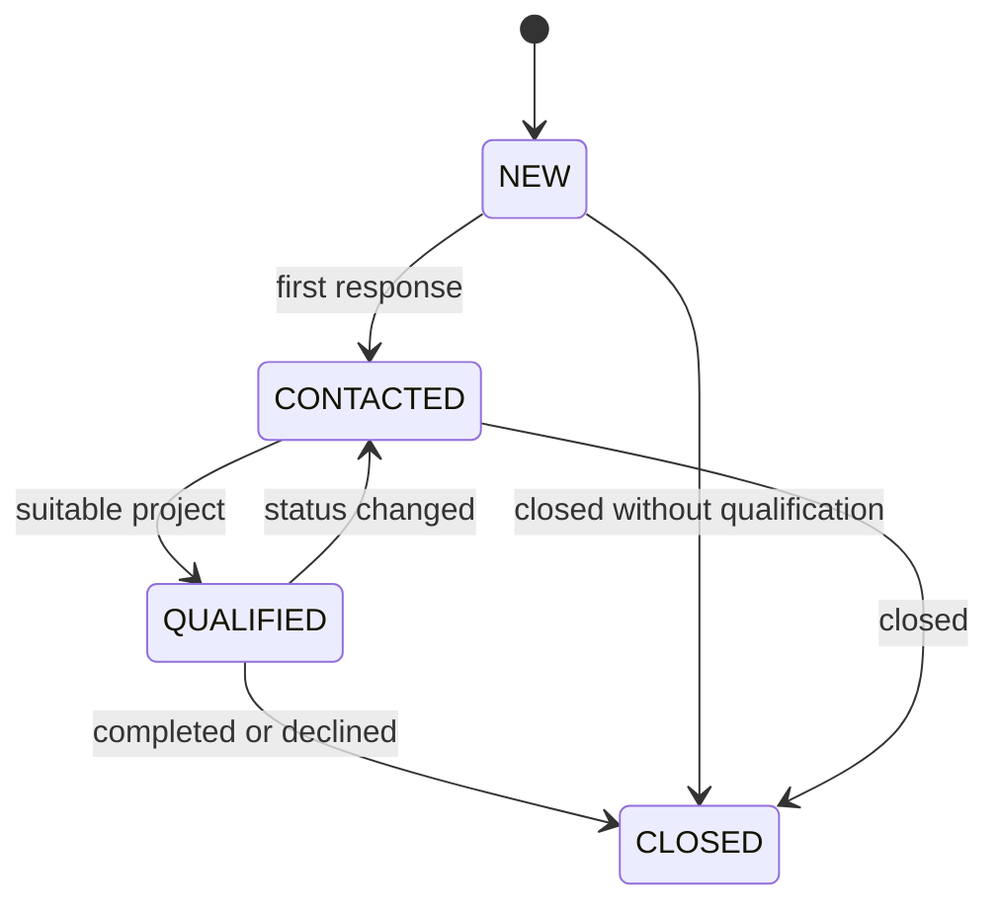
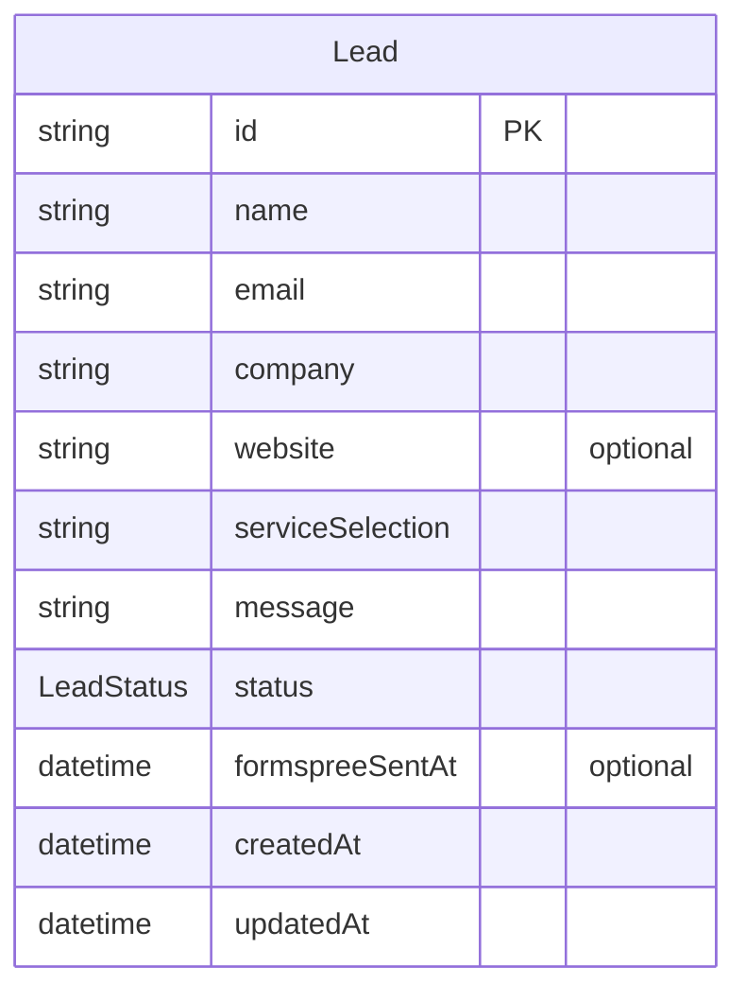

# Ethixweb

Ethixweb is a responsive website for an independent digital studio rooted in India. It presents the studio’s services and working approach, collects project enquiries, and provides a private lead management area for administrators.

## Tech stack

- **Next.js 16 App Router** with React 19 and TypeScript
- **CSS and Tailwind CSS 4** for the visual system and responsive layouts
- **Three.js** for the interactive network globe
- **PostgreSQL** with Prisma ORM 7 for lead storage
- **Clerk** for admin authentication
- **Cloudflare Turnstile** and a honeypot field to reduce automated form spam
- **Formspree** to deliver email notifications for new enquiries

## Design rationale

The site uses a dark, editorial studio aesthetic with warm ivory typography, wine backgrounds, and coral, terracotta, and saffron accents. The light theme keeps the same warm palette on a pale paper-like surface. Large display typography gives each page a clear entry point; fine rules, small uppercase labels, and restrained diagrams add structure without competing with the content.

Interactive details are intended to explain the work: the globe suggests a connected team, service illustrations show system relationships, process cards reveal additional context, and the India clock gives the location a live detail. The mobile layout changes the desktop navigation into a compact, accessible menu and stacks content into a single readable column so the page does not depend on horizontal space.

## Main routes

| Route | Purpose |
| --- | --- |
| `/` | Studio overview and service highlights |
| `/services` | Service catalogue and engagement process |
| `/about` | Studio background and India-rooted positioning |
| `/contact` | Project enquiry form |
| `/admin` | Clerk-protected lead inbox for allowlisted administrators |
| `/sign-in`, `/sign-up` | Clerk authentication routes |
| `/api/leads` | Validates and stores form submissions, then notifies Formspree |

## Project map and request lifecycle

The app uses the Next.js App Router. Route UI lives in `app/`; shared interactive pieces live in `components/`; server-only helpers live in `lib/`; Prisma schema and committed migrations live in `prisma/`. The global design system and most responsive/theme rules are in `app/globals.css`.

| Path | Responsibility |
| --- | --- |
| `app/layout.tsx` | Root HTML, metadata, Clerk provider (when configured), shared navigation, motion wrapper, footer, and stylesheet |
| `app/page.tsx` | Home page sections, service highlights, ticker, illustrative work examples, and shared interactive components |
| `app/services/page.tsx` | Service catalogue and engagement process |
| `app/about/page.tsx` | Studio story, India-rooted positioning, and operating model |
| `app/contact/page.tsx`, `components/contact-form.tsx` | Contact page and browser-side form behavior, validation, Turnstile widget, and request state |
| `app/api/leads/route.ts` | Public form endpoint: anti-spam checks, validation, database insert, then Formspree notification |
| `app/admin/page.tsx`, `app/admin/actions.ts` | Protected lead inbox and admin mutations |
| `lib/admin.ts` | Clerk session and `ADMIN_EMAILS` authorization check (`requireAdmin`) |
| `lib/db.ts` | Shared Prisma client backed by `pg` and `@prisma/adapter-pg` |
| `lib/formspree.ts` | Server-side validation of the Formspree endpoint URL |
| `proxy.ts` | Clerk middleware for admin/auth/API paths when Clerk keys exist |
| `prisma/schema.prisma`, `prisma/migrations/` | Database model and deployable migration history |
| `components/global-traffic-globe.tsx` | Three.js globe, place markers, arcs, drag interaction, and fallback behavior |
| `components/site-nav.tsx`, `components/site-footer.tsx` | Shared responsive navigation and footer |
| `components/theme-toggle.tsx`, `app/globals.css` | Theme state and design tokens/theme-specific styling |

### Lead form and database behavior

`POST /api/leads` accepts `FormData`: `name`, `email`, `company`, optional `website`, `service_selection` (comma-and-space-separated allowed service labels), `message`, `fax_only` (honeypot), `form_started_at` (timestamp), and `cf-turnstile-response` (Turnstile token). The endpoint checks the origin when supplied, bot signals, service values, field bounds, email, and website URL. It inserts the lead first; Formspree is a separate notification attempt. `formspreeSentAt` is set only after Formspree accepts the request and the status update succeeds. A notification failure does not roll back the saved lead.

The form can report success while also indicating that notification delivery is delayed. In that case the administrator can use **Retry notification** in `/admin`. The retry action reads the persisted lead and sends the same contact data to Formspree.

### Admin authorization and actions

Clerk handles sign-in, but a signed-in user is not automatically an administrator. `requireAdmin()` requires Clerk configuration, an authenticated Clerk user, and a primary email present in `ADMIN_EMAILS`; the comparison is case-insensitive and trims whitespace around comma-separated entries. Every server action checks this gate on the server. The page itself uses `getAdminAccess()`: a signed-in visitor who is not allowlisted sees an access-denied screen with a sign-out option instead of a blank 404, and no lead data is queried for them. Admin actions update status (`NEW`, `CONTACTED`, `QUALIFIED`, `CLOSED`), delete a lead, or retry its Formspree notification.



## Fresh checkout and database setup

1. Install the pinned dependencies with `npm install`.
2. Create `.env.local` using the variable list above. For a working contact flow, configure PostgreSQL, Turnstile, and Formspree. For admin access, configure Clerk and include the admin's primary email in `ADMIN_EMAILS`.
3. Apply committed migrations to the intended database and generate the Prisma client:

   ```bash
   npx prisma migrate deploy
   npx prisma generate
   ```

4. Start the app with `npm run dev` and open `http://localhost:3000`.

If `/admin` or form submission fails with `The table public.Lead does not exist`, the database pointed to by `DATABASE_URL` has not received the `Lead` migration (or the app is pointed at a different database than expected). Check the target database before applying migrations; then run `npx prisma migrate deploy` against that database. Do not resolve this by manually creating a table: the committed migration also creates the enum and indexes Prisma expects.

`npm run build` runs Prisma generation through the `prebuild` lifecycle and then builds Next.js. `npm run lint` runs ESLint. The Prisma 7 datasource URL is supplied by `prisma7.config.ts`, not inline in `schema.prisma`.

## Handoff notes for the next contributor

- Read this README and `docs/lead-intake-setup.md` before changing auth, database, or form delivery.
- Preserve the durable database insert before external Formspree delivery; notification failure should remain retryable from `/admin`.
- Keep authorization checks in `requireAdmin()` and in every server action. Hiding an admin link in the UI is not an access control.
- Keep secrets server-side. Only Clerk's publishable key and Turnstile's site key are public by design; `DATABASE_URL`, `CLERK_SECRET_KEY`, `TURNSTILE_SECRET_KEY`, and `FORMSPREE_ENDPOINT` must not be exposed through `NEXT_PUBLIC_` variables.
- The in-memory API rate limiter is per process and does not coordinate across serverless instances. Use a shared store if production requires consistent multi-instance throttling.
- Styling is concentrated in one long global stylesheet with accumulated responsive and theme overrides. Check dark/light mode and narrow phone widths when modifying shared components or cards.
- The globe uses approximate hand-authored land polygons and illustrative locations/arcs. Treat it as a visual illustration, not a geographic or live traffic data source.
- Avoid presenting illustrative service/work examples as client case studies or measured outcomes.
- The `User` Prisma model is currently not used by the app's admin flow; Clerk is the identity source. Confirm whether it is needed before building features around it.

## Local setup

Use Node.js compatible with the installed Next.js version and npm.

```bash
npm install
npm run dev
```

Create `.env.local` and set the environment variables below. Never commit secret values. Database setup and Turnstile/Formspree configuration are described in [`docs/lead-intake-setup.md`](docs/lead-intake-setup.md).

| Variable | Used for |
| --- | --- |
| `DATABASE_URL` | PostgreSQL connection string |
| `NEXT_PUBLIC_CLERK_PUBLISHABLE_KEY` | Clerk browser integration |
| `CLERK_SECRET_KEY` | Clerk server integration |
| `ADMIN_EMAILS` | Comma-separated email allowlist for `/admin` |
| `NEXT_PUBLIC_TURNSTILE_SITE_KEY` | Turnstile browser widget |
| `TURNSTILE_SECRET_KEY` | Server-side Turnstile verification |
| `TURNSTILE_HOSTNAME` | Optional expected hostname for Turnstile responses |
| `FORMSPREE_ENDPOINT` | Server-only Formspree endpoint used for email notifications |

Keep `FORMSPREE_ENDPOINT` in server environment settings; do not prefix it with `NEXT_PUBLIC_`. For production, configure the matching Formspree form settings and verified Turnstile keys. The form ID is an endpoint identifier, not an authentication secret, so moving it to an environment variable prevents hardcoding but does not make the Formspree endpoint private or block direct submissions to it.

## Form submission flow

The browser validates required fields and submits to the application API. The API checks request origin, honeypot, completion time, request rate, Turnstile, and field values. Accepted enquiries are stored in PostgreSQL before a notification is sent to Formspree. If notification delivery fails, the saved lead remains available in `/admin` for a retry.



## Admin lead management

`/admin` is protected by Clerk and an additional `ADMIN_EMAILS` allowlist. Server actions re-check the administrator before changing a lead. Administrators can review enquiries, update their status, delete a lead, and retry a failed Formspree notification.





## Data model

Each `Lead` stores contact details, selected services, the project message, its workflow status, and whether Formspree accepted the notification. The database schema indexes status/date and email for common inbox lookups.



## Development commands

```bash
npm run dev       # start the local development server
npm run build     # generate Prisma Client, then build the production app
npm run start     # serve a production build
npm run lint      # run ESLint
```

Prisma schema and migrations are in `prisma/`. Use the repository’s Prisma 7 configuration and review the setup guide before applying migrations to a database.

## Responsive behavior and accessibility

- On narrow screens, the desktop links collapse into a menu button with an explicit accessible name and expanded state.
- The open menu supports Escape, returns focus to its trigger, locks background scrolling, and keeps its contents scrollable on short screens.
- Service, process, work, contact, story, and network layouts stack to one column at phone widths; form controls and admin details are allowed to shrink and wrap.
- Color themes preserve contrast for navigation, diagrams, cards, and form fields.

## Issues addressed during implementation

- The desktop navigation did not have enough room on phone screens. A dedicated mobile header and fixed, scrollable navigation panel replace the crowded horizontal links at small widths.
- Several content sections retained multi-column desktop sizing and could overflow or compress on phones. Responsive overrides now stack those grids and form fields, with tighter sizing for very narrow viewports.
- The global stylesheet contains legacy rules and theme overrides, so later responsive rules need to be checked against selector specificity and both themes.
- The globe’s interaction needed stable drag state and continuous rotation; its implementation uses a Three.js scene with pointer interaction and a non-WebGL fallback.
- Form delivery spans two systems: PostgreSQL is the durable record, while Formspree is the email notification channel. Keeping those outcomes separate lets the admin retry notification delivery without losing the enquiry.

The API rate limit currently uses in-memory process state. For multi-instance production hosting, move that limit to a shared store so requests are counted consistently across instances.
